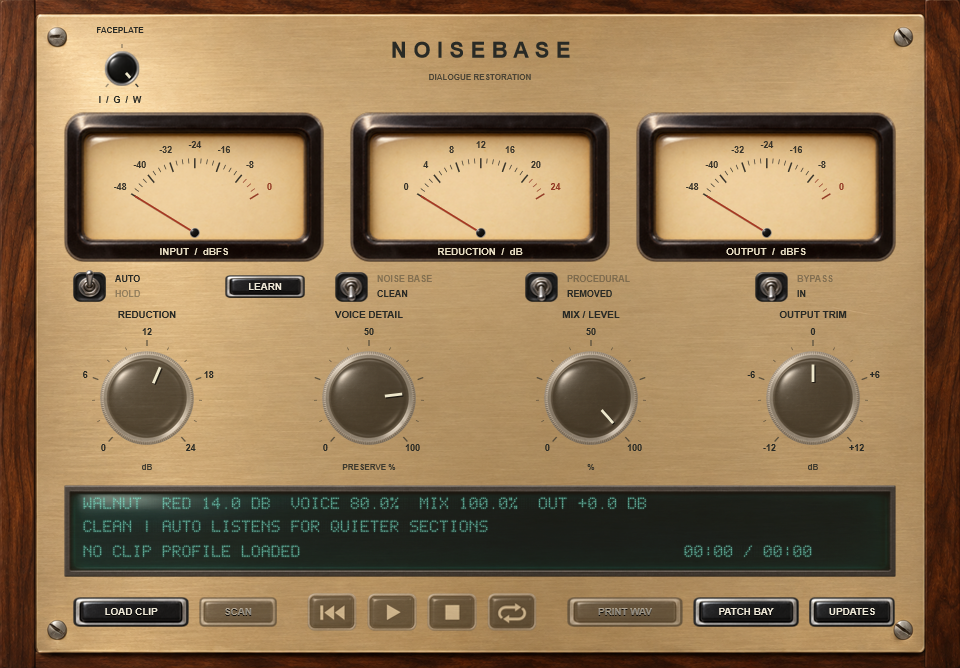

# NoiseBase

Automatic dialogue denoising and procedural ambience for Windows x64 and Apple Silicon macOS, available as a VST3 effect and a standalone application.

[Download the latest NoiseBase release](https://github.com/lakam99/NoiseBase/releases/latest)



NoiseBase learns persistent background noise from pauses in speech and applies spectral noise reduction. A local Silero voice activity detector helps keep speech out of the noise profile. Audio processing runs on your computer without an account, API key, or upload.

The standalone application scans the entire recording and follows different backgrounds across stitched clips during preview and export. The VST3 automatically follows noise changes in the audio played through it. Select **HOLD** to freeze the current profile.

## Features

- Automatic whole-file noise profiling, with local profiles for changing backgrounds and speech-aware live adaptation.
- Reduction, voice detail, dry/clean blend, output trim, and latency-aligned bypass.
- Continuous procedural ambience from one reference clip, saved with the session.
- Removed-noise monitoring, plus procedural seamless-loop and noise-base WAV export.
- Mono and stereo processing with a shared stereo mask.
- Standalone file loading, automatic scanning, playback, and WAV export.
- Classic cyan VFD for live values, filename, tape status, progress, and time.
- Generated transport icons for play/pause, stop, loop, and return to beginning.
- Ivory, Graphite, and Walnut skins with generated PNG faceplates and hardware artwork. Labels, needles, scales, and knob pointers remain live.
- Host automation and saved control/skin state.

## Install and use

**Apple Silicon Mac (M1/M2 and later):** requires macOS 14 Sonoma or later. Extract the `macOS-arm64.zip`, copy `NoiseBase.app` to Applications, and copy the complete `NoiseBase.vst3` bundle to `~/Library/Audio/Plug-Ins/VST3`. Use a native arm64 DAW. The Mac package is ad-hoc signed, not Developer ID signed or notarized; see the [Mac guide](docs/macOS-user-guide.txt) and [Apple's opening guidance](https://support.apple.com/en-us/102445). Mac update checks open the release page for manual installation. No Intel or AU build is included.

**Windows x64:**

Download and extract the Windows ZIP from [Releases](https://github.com/lakam99/NoiseBase/releases).

Run `Install-NoiseBase.ps1` from the extracted `NoiseBase` folder. It installs the standalone app, its update helpers, a Start menu shortcut, and the VST3 in your user account. It requires no administrator rights. Use Windows Installed Apps to uninstall it; recordings and user settings are preserved.

For standalone use, launch **NoiseBase** from Start. Choose **LOAD CLIP**, wait for the automatic scan, then **PLAY** and adjust the controls. **PRINT WAV** writes the selected output and preserves the source. Portable use through `Standalone/NoiseBase.exe` is also supported; keep all bundled DLLs and helper scripts beside it. In-app installation requires an installed copy.

The installer also installs the VST3. Alternatively, copy the entire `VST3/NoiseBase.vst3` directory into a VST3 plug-in folder. Restart or rescan the DAW. Leave **AUTO** selected: learning starts automatically and follows stable changes during speech pauses. **HOLD** keeps the active floor fixed. With a loaded file, **LEARN** re-analyzes the entire file and selects AUTO again. Without a loaded file, it resets learning from incoming DAW audio. A conventional VST3 cannot read future or unplayed host audio; use **LOAD CLIP** to scan a complete file for file export.

The application is installed at `%LOCALAPPDATA%/Programs/NoiseBase`; the VST3 goes to `%LOCALAPPDATA%/Programs/Common/VST3/NoiseBase.vst3`. Add the latter's parent folder to your DAW's plug-in locations if necessary. VST3 backups are retained outside that scan folder. The installer verifies payload hashes, protects unowned directories, refuses downgrades and in-use files, and rolls back failed file swaps. See the [Windows user guide](docs/Windows-user-guide.txt).

The standalone tape deck uses icon buttons. **Play/pause** toggles playback, **stop** stops and rewinds, **return to beginning** jumps to zero while preserving play or pause, and **loop** repeats the recording during preview. A green jewel and `LOOP ON` in the VFD indicate that repeat is enabled. Disabling loop finishes the current pass. Clean and removed-noise exports process the original duration once. Procedural mode generates continuously and has its own export duration.

## Procedural noise profile and continuous ambience

Choose **LOAD CLIP** in either format, or drop one reference recording onto the faceplate. After the quiet-section scan, select **NOISE BASE** and **PROCEDURAL**. The generator creates fresh background continuously from the learned noise spectrum, channel levels, stereo correlation and gentle level variation. It carries on beyond the reference length and with silent host input. The standalone play/pause button controls generation; its elapsed display shows `INF`. The VST3 generates while the host processes it; host suspension or stopped processing also stops generation.

The compact statistical model is saved in DAW state and standalone preferences. It stores no recorded waveform and does not need the source file after restoration. It requires at least 0.35 seconds of confidently detected quiet background; uncertain floor estimates are refused for synthesis. Detection can misclassify material, so audition the result. It generates a statistical ambience bed rather than reconstructing separate birds, vehicles, impacts or other recognizable events.

**PRINT WAV** defaults to a **60-second seamless loop**, with an editable 1–3600 second duration. Its sample rate and mono/stereo layout follow the reference. MIX sets generated level, OUTPUT TRIM adjusts gain. Reduction and voice detail affect denoising, not procedural synthesis. Bypass restores the original, including dialogue. Older sessions retain their removed-noise route until you select PROCEDURAL explicitly.

## Removed-noise monitoring

Select **NOISE BASE** and **REMOVED** for the denoiser's estimated removed-noise stem, the 1.4 behavior. It can contain dialogue bleed where speech and noise overlap. Let AUTO learn a reliable floor from a pause, then use HOLD if desired. VOICE DETAIL protects speech from removal. MIX scales removed noise; zero MIX or zero REDUCTION gives silence in this mode. Removed-noise exports retain source timing, channel layout and supported WAV format/metadata. CLEAN selects denoised dialogue again.

## Window appearance

The generated cyan/glass icon is embedded in the app, taskbar window and Windows module resources. The standalone's native title bar and utility-window colors follow Windows app light/dark mode while keeping the selected Ivory, Graphite or Walnut faceplate. Host-owned VST3 window chrome remains the DAW's responsibility.

## Automatic updates

The standalone app checks [GitHub Releases](https://github.com/lakam99/NoiseBase/releases) on startup, at most daily after a successful check. **UPDATES** offers a manual check and an automatic-check toggle. On Windows, a newer stable version offers **Download update**, then **Install and restart** after verification. The VFD shows a segmented download bar and percentage, followed by an activity indicator while verifying and unpacking. Installation preserves settings and keeps the preceding version as a backup. Close DAWs using the VST3 before installing. The VST3 itself does not check the network or replace loaded modules.

Downloads must match GitHub's SHA-256 asset digest, `SHA256SUMS.txt`, and every payload file in `release-manifest.json`. Paths and package identity are checked before installation. These checks detect corruption; release authenticity depends on HTTPS and this repository's security. Releases are not Authenticode-signed.

## Release pipeline

[Windows and Apple Silicon release](https://github.com/lakam99/NoiseBase/actions/workflows/release.yml) runs on main, pull requests, and stable version tags. Only a tag matching the CMake version publishes a release. Both platform jobs must pass. The pipeline scans source/history, builds both formats, verifies audio and file workflows, tests Windows installation/rollback/update policy and Mac signatures, scans nested release archives, then uploads and verifies assets before publishing. Actions are pinned to full commit hashes; publishing uses a separate job with write permission.

To release a new version, update the CMake project version and release notes, commit, then push the corresponding `vMAJOR.MINOR.PATCH` tag. Manual workflow runs build and verify without publishing.

If publishing fails after a successful build, use **Resume verified release publication** with the original workflow run ID and stable tag. It verifies that the successful build belongs to that exact tag commit and repository, retrieves its artifact, and retries upload/digest verification without rebuilding. Published releases are left unchanged unless the existing assets exactly match the checksums.

## Build from source

This repository includes the JUCE source, Silero model, generated artwork, and ONNX Runtime CPU headers/runtime required by the current build. No submodule initialization or dependency download is required. Three unused JUCE Android demo Firebase configuration files are omitted; see the [vendor notes](third_party/NOISEBASE-VENDOR-NOTES.md).

Requirements: Windows x64, Visual Studio 2022 C++ Build Tools with Windows SDK, and CMake 3.22 or newer.

For Apple Silicon, install Xcode command-line tools and CMake, then run `cmake -S . -B build -DCMAKE_BUILD_TYPE=Release -DCMAKE_OSX_ARCHITECTURES=arm64 -DCMAKE_OSX_DEPLOYMENT_TARGET=14.0` followed by `cmake --build build --target NoiseBase_VST3 NoiseBaseStandalone --parallel 3`. The app is in `build/NoiseBaseStandalone_artefacts/Release/NoiseBase.app`. `python3 scripts/Test-Mac.py` runs native validation on a Mac with a graphical login session.

```powershell
git clone https://github.com/lakam99/NoiseBase.git
cd NoiseBase
.\Build-source.ps1
```

Build outputs:

- `build/NoiseBaseStandalone_artefacts/Release/NoiseBase.exe`
- `build/NoiseBase_artefacts/Release/VST3/NoiseBase.vst3/`

The build copies the required runtime DLLs alongside both formats. See [BUILDING.txt](BUILDING.txt) for the Ninja option and command-line verification utilities.

## Verification and limits

Release verification covers engine timing/bypass/stereo checks at 44.1, 48, and 96 kHz, stitched-background scans, VST3 loading/state/editor creation and repeated removal, delayed speech-worker cleanup, and the standalone load/scan/preview/export workflow. An independent visual critic reviewed the native skins and VFD update progress. See the [1.6.0 release notes](docs/Release-1.6.0.md); native reports are included in release packages. The reported Studio Pro freeze has not been reproduced in that DAW, and physical audio devices have not been certified by these tests.

Reported latency is 2048 samples at 44.1/48 kHz and 4096 samples at 96 kHz; standalone file export compensates this delay. This processor targets dialogue with persistent background noise. Strong wind impacts, clipping, and overlapping voices may remain. Large reduction settings can soften speech, so audition the result.

## Artwork and licenses

The interface uses generated PNG assets rather than SVG artwork. The images and exact built-in image generation prompts are in [resources/generated](resources/generated). Additional skin previews are in [docs/images](docs/images).

NoiseBase source is supplied under **AGPL-3.0-or-later**; see [LICENSE](LICENSE). This build uses JUCE's AGPL option. Third-party code, models, and notices retain their respective licenses, preserved in [Licenses](Licenses), `third_party`, and `resources`.

Included versions: JUCE 9.0.6 and ONNX Runtime CPU 1.32.0.
